<div align="center">



<br />

<a href="https://nicoverse.netlify.app/"></a>
<a href="https://www.linkedin.com/in/nicolasdanielsantos/"></a>
<a href="mailto:nicolas.d.daniell@gmail.com"></a>

<br /><br />


<br />

<code>SECURITY FIRST · BUILD WITH PURPOSE · KEEP LEARNING</code>

</div>

---

## `root@nicolas:~$ whoami`

Sou **Nicolas Daniel Santos**, estudante de **Análise e Desenvolvimento de Sistemas no IFSP Campinas** (previsão de conclusão: **2027**). Tenho como área de maior interesse a **Segurança Cibernética**, com foco em desenvolvimento seguro, proteção de aplicações e evolução em Cloud Security.

Também atuo em **iniciação científica com Inteligência Artificial**, estudando **Python e Large Language Models (LLMs)**, com exploração de tecnologias e ecossistemas como **OpenAI e Anthropic**. Conecto esses estudos à minha experiência com aplicações Full Stack, APIs e bancos de dados.

> 🛡️ **Minha filosofia:** não basta construir sistemas que funcionem. Quero entender como protegê-los, testá-los e torná-los mais confiáveis.

```yaml
operator: Nicolas Daniel Santos
location: Campinas, SP - Brazil
education: Análise e Desenvolvimento de Sistemas | IFSP | 2027
primary_focus: Cybersecurity
research: Iniciação Científica | Inteligência Artificial
research_stack: [Python, LLMs, OpenAI, Anthropic]
engineering: [Secure Coding, Web Applications, REST APIs, Databases]
cloud: [AWS, Azure]
career_target: Estágio em Segurança da Informação, Desenvolvimento ou Cloud
status: learning_and_building
```

---

## `./research_lab --topic "AI + Python + LLMs"`

<table>
<tr>
<td width="100%">

### 🧠 Iniciação Científica | Inteligência Artificial

**Pesquisa e estudos em Python e Grandes Modelos de Linguagem (LLMs)**

Estou aprofundando conhecimentos em programação Python e no funcionamento e utilização de **Large Language Models**, incluindo o estudo de ferramentas relacionadas aos ecossistemas **OpenAI** e **Anthropic**.

**Frentes de estudo:** fundamentos de LLMs, integração de aplicações com IA, engenharia de prompts, experimentação e avaliação de respostas.

**Conexão com Cybersecurity:** interesse em uso responsável de IA, proteção de dados, segurança de integrações e análise de riscos em aplicações baseadas em modelos de linguagem.

<code>RESEARCH_STATUS: EM DESENVOLVIMENTO</code> · <code>PYTHON</code> · <code>LLMs</code> · <code>GENAI</code>

</td>
</tr>
</table>

---

## `cat /etc/security-mindset.conf`

<div align="center">



</div>

Meu foco de estudo em **Cybersecurity** está no lado defensivo e na prevenção de vulnerabilidades ao longo de todo o ciclo de desenvolvimento:

| Domínio | Estudos e práticas |
| :-- | :-- |
| **Application Security** | OWASP Top 10, SQL Injection, XSS, IDOR e validação de entradas |
| **Identity & Access** | Autenticação, autorização, controle de acesso e menor privilégio |
| **API Security** | Controle de permissões, validação de dados e proteção de endpoints |
| **Security Engineering** | Secure by Design, análise de riscos, logs e boas práticas de código |
| **Cloud Security** | Fundamentos de segurança em AWS e Azure |
| **AI Security** | Interesse em riscos de aplicações com LLMs e proteção de dados |

```text
[ SECURITY PRINCIPLES ]
  01 > Validate inputs; never trust by default
  02 > Enforce authorization at every boundary
  03 > Protect secrets, identities and data
  04 > Log relevant events and reduce exposure
  05 > Design security into the architecture
```

---

## `ls /opt/tech-stack --classified`

<div align="center">

**LANGUAGES & DEVELOPMENT**


**SECURITY · CLOUD · DATA · TOOLING**


</div>

| Trilha | Aplicação |
| :-- | :-- |
| 🛡️ **Cybersecurity** | Desenvolvimento seguro, OWASP e fundamentos de proteção de sistemas |
| 🧠 **AI / LLMs** | Python, experimentação com modelos de linguagem e aplicações com IA |
| 💻 **Full Stack** | Interfaces web, APIs REST, backend e persistência de dados |
| ☁️ **Cloud & DevOps** | AWS, Azure, Docker, versionamento e ambientes de desenvolvimento |

---

## `./projects --selected --show-evidence`

Projetos que representam diferentes partes da minha trajetória técnica, da engenharia de software à Inteligência Artificial.

<table>
<tr>
<td width="50%" valign="top">
<h3>🛡️ SalonTech 2</h3>
<p>Sistema web para operações de salão com backend em Node.js/Express, autenticação e persistência em PostgreSQL.</p>
<p><code>Node.js</code> <code>Express</code> <code>PostgreSQL</code></p>
<a href="https://github.com/nicolasdanieldev/SalonTech2"><strong>INSPECT_REPOSITORY ↗</strong></a>
</td>
<td width="50%" valign="top">
<h3>🤖 ChatGPT Clone + Memory</h3>
<p>Chatbot em Python com memória de conversação e integração com modelos de linguagem, usando LangChain e OpenAI API.</p>
<p><code>Python</code> <code>LangChain</code> <code>OpenAI API</code> <code>Gradio</code></p>
<a href="https://github.com/nicolasdanieldev/Chatgpt-Clone-Memory"><strong>INSPECT_REPOSITORY ↗</strong></a>
</td>
</tr>
<tr>
<td width="50%" valign="top">
<h3>🐍 Python Algorithms with AI</h3>
<p>Laboratório de algoritmos, organização modular, testes e boas práticas de engenharia de software com apoio de IA.</p>
<p><code>Python</code> <code>Testing</code> <code>Clean Code</code></p>
<a href="https://github.com/nicolasdanieldev/python-algorithms-with-ai"><strong>INSPECT_REPOSITORY ↗</strong></a>
</td>
<td width="50%" valign="top">
<h3>📊 TechFinance</h3>
<p>Aplicação para acompanhar movimentações financeiras, saldo e metas, com recursos web e integração de dados.</p>
<p><code>JavaScript</code> <code>Node.js</code> <code>REST API</code></p>
<a href="https://github.com/nicolasdanieldev/tech-finances-v2"><strong>INSPECT_REPOSITORY ↗</strong></a> · <a href="https://tech-finances-v2.onrender.com/"><strong>LIVE_DEMO ↗</strong></a>
</td>
</tr>
</table>

<div align="center">

<a href="https://github.com/nicolasdanieldev?tab=repositories"></a>

</div>

---

## `ls ~/.credentials --verified-learning`

<div align="center">


</div>

---

## `./github_telemetry --contributions --live`

<div align="center">



<br />


<br />

<a href="https://github.com/nicolasdanieldev"></a>

</div>

<sub>O painel superior é uma ilustração temática. O gráfico de atividade é gerado por um serviço externo com base em dados públicos e pode variar conforme sua disponibilidade.</sub>

---

## `cat roadmap_2026_2027.yaml`

```yaml
priority_01:
  domain: Cybersecurity
  topics: [OWASP, API Security, Threat Modeling, Secure Coding]

priority_02:
  domain: Scientific Research in AI
  topics: [Python, LLMs, Prompt Engineering, Responsible AI]

priority_03:
  domain: Cloud & Software Engineering
  topics: [AWS, Azure, APIs, Containers, Software Architecture]

next_step:
  - Consolidar laboratórios e documentação técnica
  - Integrar segurança às aplicações que desenvolvo
  - Evoluir em pesquisa aplicada com Inteligência Artificial
```

---

<div align="center">

### `sudo open-secure-channel --connect`

**Interesse em oportunidades de estágio em Cybersecurity, Desenvolvimento de Software e Cloud, além de projetos de pesquisa em IA.**

<a href="https://nicoverse.netlify.app/"></a>
<a href="https://www.linkedin.com/in/nicolasdanielsantos/"></a>
<a href="mailto:nicolas.d.daniell@gmail.com"></a>

<br /><br />

<code>NICOLAS_OS // SECURITY_BY_DESIGN // RESEARCH_IN_PROGRESS</code>


</div>
